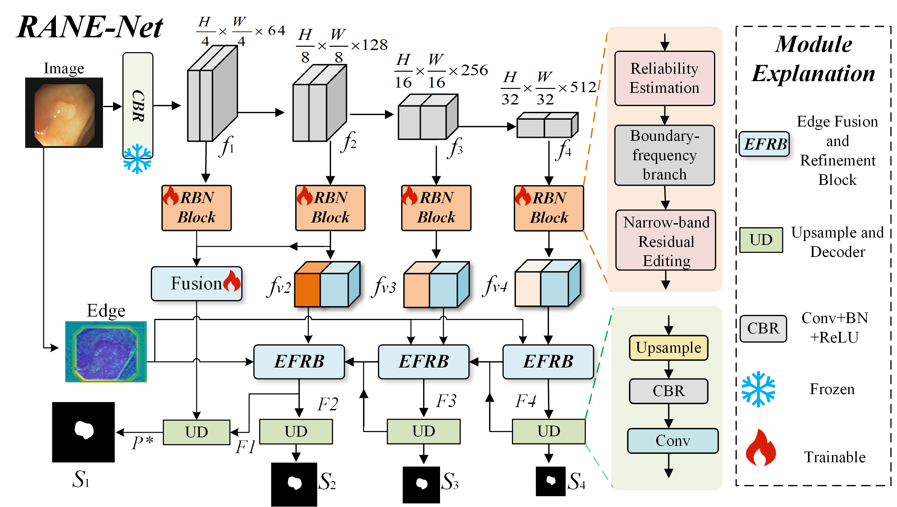
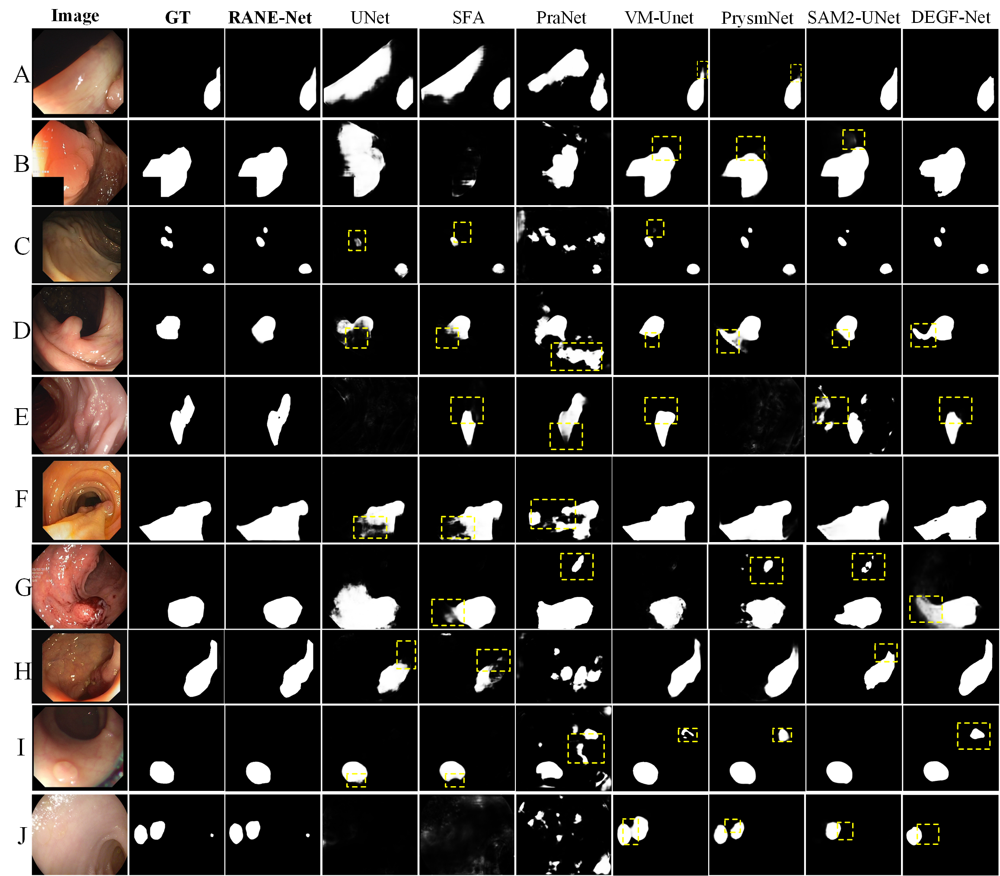

# RANE-Net

### Reliability-Adaptive Narrow-band Editing for Polyp Segmentation

Official repository for **RANE-Net: Reliability-Adaptive Narrow-band Editing for Polyp Segmentation**.

> **Code availability:** All code will be made publicly available in this repository after the paper is accepted by **Medical Image Analysis (MIA)**.

## Overview

RANE-Net is a reliability-conditioned editing framework for polyp segmentation in colonoscopy images. It combines regional predictions, boundary-frequency evidence, and image context to control where and how strongly local refinement is applied before multiscale semantic reconstruction.

- **Reliability-adaptive refinement:** Complementary regional and boundary-informed predictions, together with image context, determine the reliability of local corrections.
- **Narrow-band editing:** Soft contour bands, learned editing strength, and bounded residual refinement focus updates around lesion boundaries.
- **Multiscale reconstruction:** Four RBN blocks refine projected features from a frozen ResNet-50 backbone. Image-derived edges guide three Edge Fusion and Refinement Blocks (EFRBs), followed by progressive decoding and shallow feature fusion.

## Model architecture

The overall architecture of RANE-Net. Snowflakes indicate the frozen backbone; flames indicate trainable modules. Edge guidance enters EFRB4, EFRB3, and EFRB2, and the finest prediction provides the final segmentation.

## Benchmark results

The default **RANE-Net-B** configuration achieves the following mean Dice and IoU scores in the manuscript:

| Dataset | Evaluation domain | Dice | IoU |
| --- | --- | ---: | ---: |
| Kvasir-SEG | Seen | 0.959 | 0.923 |
| CVC-ClinicDB | Seen | 0.933 | 0.894 |
| CVC-300 | Unseen | 0.925 | 0.876 |
| CVC-ColonDB | Unseen | 0.825 | 0.748 |
| ETIS-LaribPolypDB | Unseen | 0.802 | 0.724 |

The fixed training split contains 900 Kvasir-SEG images and 550 CVC-ClinicDB images. The remaining three datasets are used for unseen-domain evaluation. Scores are computed per image and averaged within each dataset.

## Qualitative segmentation comparison

Main segmentation comparison on ten representative images (A–J). Columns show the input image, ground truth (GT), RANE-Net, U-Net, SFA, PraNet, VM-UNet, PrysmNet, SAM2-UNet, and DEGF-Net. Yellow dashed boxes highlight local contour differences or additional foreground responses.
